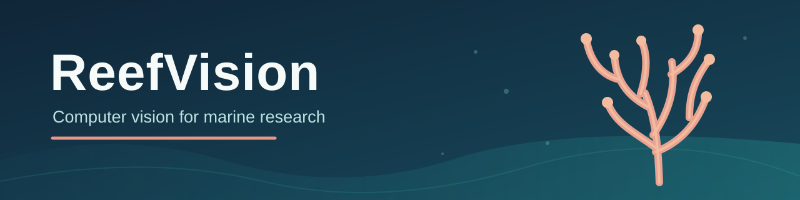
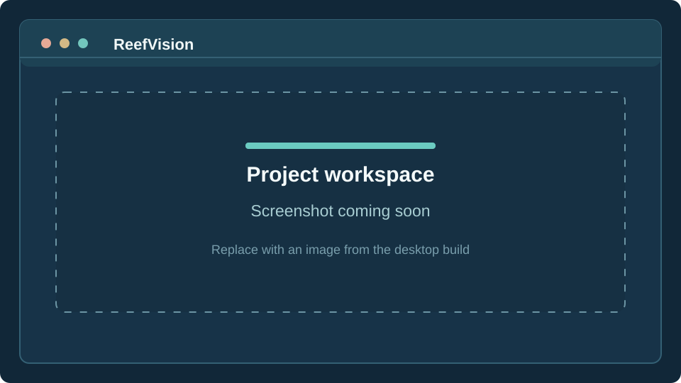
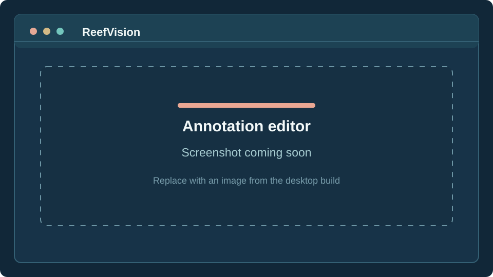
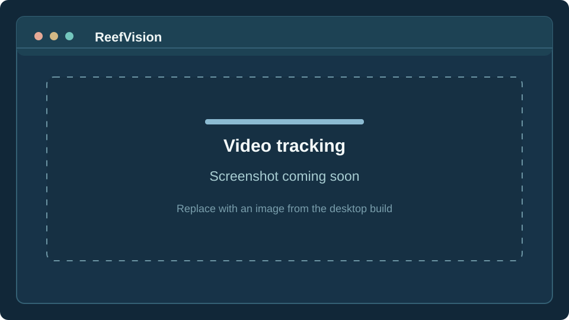
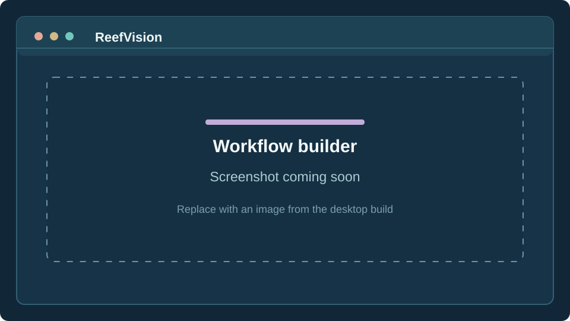

  

  Desktop software for marine image and video analysis. 
  Annotation, model training, tracking, measurements, and review in one local workspace.

  

  <strong><a href="https://github.com/Rafael-Del-Valle/ReefVision/releases/latest/download/ReefVision_Windows_Downloader.exe">Download Windows installer</a></strong>
  · <a href="https://github.com/Rafael-Del-Valle/ReefVision/releases/latest">Latest release and checksums</a>
  · <a href="#installation">Installation</a>
  · <a href="#documentation">Documentation</a>
  · <a href="https://github.com/Rafael-Del-Valle/ReefVision/issues">Report an issue</a>

  
  
  

---

ReefVision is built for researchers who work with large sets of underwater images and video. The idea is simple: keep the images, annotations, model results, and checks together, rather than moving between unrelated tools at every stage of a project.

It began with octocoral imagery, but the annotation and computer-vision workflows can also be used for other marine research datasets. ReefVision runs on your computer, and projects and research records are managed locally.

## What you can do

| Area | Tools |
| --- | --- |
| **Annotate images** | Bounding boxes, rotated boxes, polygons, brush masks, Fill, class management, and editable segmentation results. |
| **Train and run models** | Detection, segmentation, and image classification workflows using supported local models. Review predictions before including them in verified annotations. |
| **Work with video** | Object detection and tracking with ByteTrack or BoT-SORT, plus annotated video exports and tracking summaries. |
| **Measure corals** | Centerlines, scale and calibration tools, and measurements derived from masks or annotated geometry. |
| **Review datasets** | Quality-control checks, ranked review queues, versioned annotation snapshots, dataset exports, and active-learning workflows. |
| **Build repeatable workflows** | Visual workflow graphs with saved revisions, execution history, review steps, and artifact records. |

For a more detailed list, see the [feature reference](docs/FEATURE_REFERENCE.md). Some tools depend on a compatible model, GPU, or separately installed provider.

## Updates in 1.0.1 and 1.0.2

**1.0.1** adds image-wide SAM 2.1 proposals, selected-mask refinement, review-before-counting controls, immutable verified learning datasets, scientific held-out instance-mask evaluation, and audited segmentation-model promotion and rollback.

**1.0.2** builds on 1.0.1 with more reliable first-image loading, improved gallery navigation, pan and zoom, safe annotation duplication, and protected keyboard shortcuts. See the [1.0.1 notes](docs/RELEASE_1.0.1.md) and [1.0.2 notes](docs/RELEASE_1.0.2.md).

GitHub CI, Windows installer packaging, and automated clean-install checks passed for both version candidates. Owner-waived: testing on the maintainer's personal PC/GPU, and scientific performance validation with representative coral data. **Do not interpret these releases as independently validated for research accuracy.** Researchers should verify model outputs and metrics on their own datasets.

## A look at ReefVision

The panels below mark where screenshots from the desktop application will go. They are **placeholders, not screenshots**.

| Project workspace | Annotation editor |
| :---: | :---: |
|  |  |
| Browse projects and organize imagery. | Draw, edit, and review annotations. |

| Video tracking | Workflow builder |
| :---: | :---: |
|  |  |
| Review tracks and export annotated video. | Connect analysis steps and review results. |

## Installation

ReefVision is distributed for Windows x64. The packaged desktop application does not need Python or Node.js.

1. **[Download the Windows downloader](https://github.com/Rafael-Del-Valle/ReefVision/releases/latest/download/ReefVision_Windows_Downloader.exe)** from the latest stable GitHub release.
2. Run `ReefVision_Windows_Downloader.exe`. It selects the newest complete ReefVision Windows release and downloads its MSI plus **every required external CAB file** into the same folder under Downloads.
3. It verifies each file against the published SHA-256 provenance and then lets you launch the installer.

The downloader is unsigned, so Windows may warn that its publisher is unknown. Only use downloads from this official repository. To restrict selection to stable releases, run the downloader with `--stable`. For direct installation, retrieve the MSI **and all accompanying CAB files** from the [release assets](https://github.com/Rafael-Del-Valle/ReefVision/releases/latest), then keep them together in one folder.

**Working from source?** See the [developer setup guide](docs/DEVELOPMENT.md).

### Models and hardware

The stable installers do not include pretrained model checkpoints. Register a compatible local checkpoint for model-based analysis, or use the supported training tools to build your own model. GPU acceleration is useful for training and larger inference jobs; availability depends on the provider and local environment.

## A typical project

1. Create a project and import images or video.
2. Define classes and make a set of reference annotations.
3. Train or register a model, then inspect its predictions.
4. Review and correct results before treating them as verified data.
5. Save a dataset version or export the annotations, tracks, and measurements needed for analysis.

The distinction between model predictions and reviewed annotations is intentional. ReefVision keeps those states separate so that a model suggestion is not automatically treated as a confirmed observation.

## Documentation

- [Desktop installation and packaging](docs/DESKTOP_BUILD_AND_INSTALL.md)
- [Developer setup and validation](docs/DEVELOPMENT.md)
- [Feature reference](docs/FEATURE_REFERENCE.md)
- [Quality-control guide](docs/QUALITY_CONTROL_GUIDE.md)
- [Review queue guide](docs/REVIEW_QUEUE_GUIDE.md)
- [Known issues](docs/KNOWN_ISSUES.md)
- [1.0.1 release notes](docs/RELEASE_1.0.1.md)
- [1.0.2 release notes](docs/RELEASE_1.0.2.md)
- [Changelog](CHANGELOG.md)

## Development

ReefVision uses a React and Tauri desktop interface with a FastAPI backend. The repository contains the application, test suites, database migrations, Windows build scripts, and supporting research documentation.

See [CONTRIBUTING.md](CONTRIBUTING.md) for contribution guidance and the [developer setup guide](docs/DEVELOPMENT.md) for commands. Bug reports and reproducible examples are welcome in [GitHub Issues](https://github.com/Rafael-Del-Valle/ReefVision/issues).

## Research use and licensing

For research using ReefVision, record the application version, model and checkpoint used, dataset version, and how model outputs were reviewed. A formal software citation has not yet been published.

### Open-source software license

ReefVision's original source code and project documentation are available under the [MIT License](LICENSE).

Copyright (c) 2026 Rafael Del Valle.

The MIT License allows researchers, nonprofit organizations, and commercial teams to use, modify, and redistribute the licensed software, including in other projects, provided the copyright and license notices are retained. Contributors and downstream users are not required to publish their modifications. ReefVision remains an independently maintained project; the license does not transfer ownership of the original code.

**Research data and third-party material:** This software license does **not** grant rights to coral or wildlife photographs and videos, annotations, research datasets, model checkpoints or weights, third-party dependencies, or materials owned by others. Such items are subject to their respective owners' terms and permissions. Availability of the software's source code should not be interpreted as permission to redistribute research data or third-party content.

For contributions, see [CONTRIBUTING.md](CONTRIBUTING.md).
